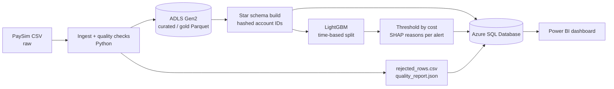

# Explainable Fraud Risk Platform (Azure + Power BI)

An end-to-end fraud analytics project: a validated data pipeline, a cost-aware fraud model with
per-alert explanations, an Azure SQL serving layer, and a Power BI dashboard for triage.
Built to show data engineering, ML, BI and responsible-AI documentation in one repository.

> **Status:** fill in the "Results" section after your real run. Everything below marked `[ ]` is yours to complete.

## Business problem
A payments team can only investigate so many alerts. Missing a fraud costs its amount; each alert costs
analyst time. The goal is not the highest AUC but the **lowest expected cost**, with alerts a reviewer can understand.

## Architecture


## Repository layout
```
src/frp/        pipeline code (ingest, build_gold, train, evaluate, load_sql, upload_adls, run_all)
sql/            optional strict T-SQL schema + views
dashboard/      Power BI guide (pages, DAX) + your .pbix and screenshots
docs/           architecture, model card, EU AI Act note, Azure setup
tests/          end-to-end smoke test on synthetic data (also runs in CI)
```

## Quick start (local demo, no Azure needed)
```bash
python -m venv .venv && source .venv/bin/activate      # Windows: .venv\Scripts\activate
pip install -r requirements.txt && pip install -e .
python -m frp.run_all --synthetic --rows 60000          # writes to a local SQLite file
pytest -q
```
The synthetic data is a small stand-in for demos and CI. **Do not report its metrics as results.**

## Real run (PaySim + Azure)
1. Download PaySim from Kaggle into `data/raw/` (one CSV). Check the licence/terms on the dataset page.
2. Follow `docs/azure_setup.md` to create the storage account and Azure SQL database.
3. `cp .env.example .env` and fill it in (never commit `.env`).
4. Run the strict (recommended) feature set, then the leaky `full` set once for comparison (see `docs/model_card.md`):
```bash
python -m frp.run_all --feature-set strict --upload
python -m frp.run_all --feature-set full --upload     # comparison only; do NOT present as your headline result
```
   To stay inside a small Azure budget set `MAX_STEP` (keeps fraud prevalence, shrinks rows) and/or `LOAD_SCOPE=test_period`.
5. Open Power BI Desktop and follow `dashboard/README.md`.

## Design decisions worth explaining in an interview
- **Time-based split**, not random: fraud patterns drift and random splits leak future information.
- **Cost-based threshold**: a missed fraud costs its amount, an alert costs `REVIEW_COST`. Change the cost and the threshold moves.
- **No balance columns in the headline model**: the PaySim dataset page says fraud transactions are cancelled, so the four balance columns must not be used for fraud detection. The `strict` set (default) uses only amount, type, hour of day and merchant flag. The `full` set keeps balance-derived features purely to show how much they inflate results.
- **Hashed account IDs** in the gold layer; raw names never reach the database.
- **Segment metrics, not fairness claims**: PaySim has no demographic fields, so this checks performance by type, amount band and time of day only.

## Results
| Feature set | PR-AUC | Precision @ threshold | Recall @ threshold | Cost with model | Cost without model |
|---|---|---|---|---|---|
| strict / conservative (headline) | 0.229 | 0.032 | 0.857 | $104,014,914 | $6,323,046,615 |
| full (leaky, comparison only) | [ ] | [ ] | [ ] | [ ] | [ ] |

> **Run details:** 6,362,620 rows ingested (0 rejected); time-based split — train 4,463,587 / val 980,416 / test 918,617; 4,006 frauds in test set; threshold = 0.02 (cost-optimised on val); ROC-AUC = 0.945; 50,000 alerts raised. Trained 2026-10-04.

Add: dashboard screenshots (`dashboard/`), `docs/figures/shap_global_importance.png`, and a 2-page insight memo.

## Limitations
- Synthetic data: results will not transfer to real payment traffic.
- No streaming, live monitoring or drift detection; the model card describes a monitoring plan only.
- Alert reasons are SHAP attributions, not causal explanations.

## Licence
MIT (see `LICENSE`). Dataset licence is separate; check Kaggle.
